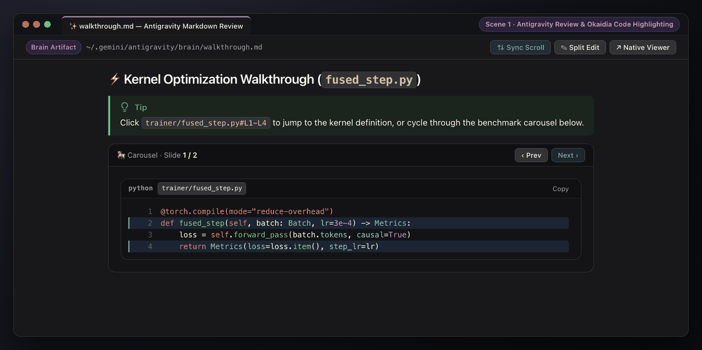
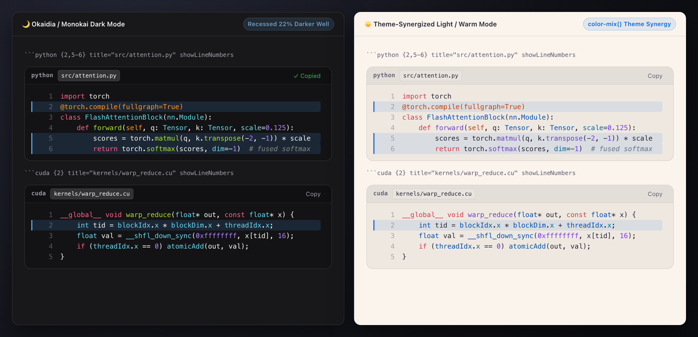
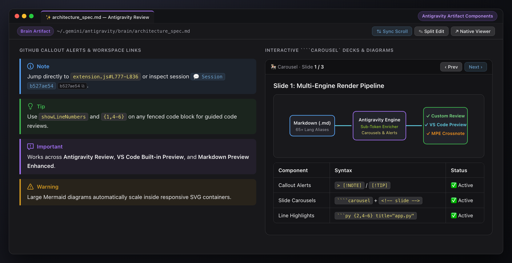
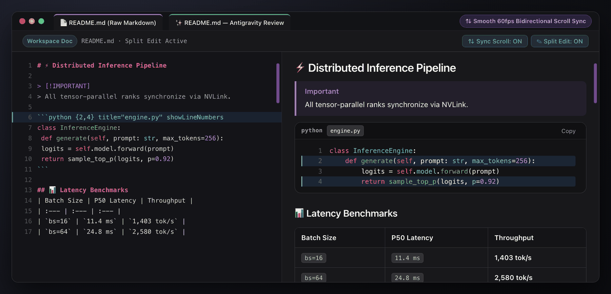

# Antigravity Markdown Review

**Google Antigravity's native Artifact Viewer styling, theme-adaptive syntax highlighting, interactive carousels, and 60fps bidirectional scroll sync for VS Code, Cursor, Windsurf, and Antigravity IDE.**



---

## ✨ Overview

**Antigravity Markdown Review** (`iamqazolp.agy-markdown-review`) brings Google Antigravity's Artifact Viewer experience to every Markdown file in your workspace. It works seamlessly across all three Markdown engines:

1. **Antigravity Markdown Review Custom Editor** (`antigravity.markdownReview`) — opens `.md` files directly in a clean review canvas with a sticky toolbar and 1-click **Split Edit**.
2. **VS Code Built-in Markdown Preview** (`markdown.showPreview`).
3. **Markdown Preview Enhanced** (`shd101wyy.markdown-preview-enhanced` / Crossnote).

---

## 🎨 Full Syntax & Line Code Highlighting



- **Active Theme Synergy & Live Syntax Palette**: Code cells, table headers, inline code pills, and callout alerts dynamically blend with your active VS Code theme's workbench surfaces (`notebook.cellEditorBackground`, `sideBar.background`) and automatically extract `semanticTokenColors` & `tokenColors` from your active editor theme (`agyMarkdown.useThemePalette`).
- **Okaidia Dark & Crisp Light Palettes**: Comprehensive `.hljs-*` (Highlight.js) and `.token.*` (Prism.js) token rules for Dark Mode, Light Mode, and PDF/Print export, including recursive highlighting for nested code fences inside ```` ```markdown ```` blocks.
- **Semantic Sub-Token Enrichment & 65+ Language Aliases**:
  - Highlights function/method invocations, `PascalCase` types/classes, `self`/`cls`/`this`/`super`, `@decorators`, Python/R keyword arguments, CUDA built-ins/qualifiers (`__global__`, `threadIdx`, `atomicAdd`), shell commands, CLI `--flags`, and `ENV_VAR=` assignments.
  - Supports 65+ aliases (`cuda`, `cu`, `ptx`, `mojo`, `triton`, `pyspark`, `ts`, `tsx`, `sh`, `zsh`, `tf`, `hcl`, `toml`, `dotenv`, SQL dialects, Diff blocks, ASCII directory trees) and auto-detects untagged code blocks.
- **Code Fence Metadata**:
  - **Line Highlighting**: ````python {1,3-5}```` or ````python hl_lines="1 3-5"````
  - **Filename Badge**: ````python title="src/attention.py"````
  - **Line Numbers**: ````python showLineNumbers```` (or globally via `agyMarkdown.codeLineNumbers`)

````markdown
```python {2,5-6} title="src/attention.py" showLineNumbers
import torch

@torch.compile(fullgraph=True)
class FlashAttentionBlock(nn.Module):
    def forward(self, q: Tensor, k: Tensor, scale=0.125):
        scores = torch.matmul(q, k.transpose(-2, -1)) * scale
        return torch.softmax(scores, dim=-1)
```
````

---

## 🧩 Antigravity Artifact Components



- **GitHub-Style Callout Alerts**: Native rendering and SVG icons for `[!NOTE]`, `[!TIP]`, `[!IMPORTANT]`, `[!WARNING]`, and `[!CAUTION]`.
- **Interactive Carousels**: Multi-slide `` ````carousel `` blocks separated by `<!-- slide -->` HTML comments with keyboard and button navigation, nesting support for code blocks, tables, alerts, and images.
- **Offline Mermaid & KaTeX**: Bundled `mermaid.min.js` diagram rendering and `katex.min.css` math typesetting (`$...$` and `$$...$$`).
- **Workspace File & Session Links**: Clickable `file:///absolute/path/to/file.py#L10-L25` links that jump directly to the exact line range in your workspace, plus `conversation://` badge pills with 1-click UUID copy.

---

## ⇅ Split Edit & Smooth Bidirectional Scroll Sync



- **1-Click Split Edit**: Click **Split Edit** in the top review toolbar to open or close the raw Markdown editor beside the preview at the exact line you are reading.
- **Smooth Bidirectional Scroll Sync (Raw ↔ Preview)**:
  - **Raw → Preview**: Frame-rate-independent `requestAnimationFrame` exponential smoothing glides the preview to match the raw editor's scroll position.
  - **Preview → Raw**: User-input-gated scroll tracking updates the raw editor on line boundaries without feedback loops or trackpad momentum interruption.
  - **Instant Toggle**: Toggle **⇅ Sync Scroll** directly from the review toolbar at any time.

---

## ⌨️ Commands

| Command ID | Title | Description |
| :--- | :--- | :--- |
| `agyMarkdown.openReview` | **Antigravity: Open Markdown Review** | Open the current Markdown file in the Antigravity Review editor |
| `agyMarkdown.openReviewBeside` | **Antigravity: Open Markdown Review to the Side** | Open the Antigravity Review editor in a side split |
| `agyMarkdown.editSource` | **Antigravity: Edit Raw Markdown** | Toggle the side-by-side raw Markdown source editor |
| `agyMarkdown.toggleSyncScroll` | **Antigravity: Toggle Synchronized Scrolling (Raw ↔ Preview)** | Enable or disable bidirectional scroll sync |
| `agyMarkdown.openNativeArtifactViewer` | **Antigravity: Open in Native Artifact Viewer** | Open a brain artifact in Antigravity's native viewer |
| `agyMarkdown.syncMpeTheme` | **Antigravity: Sync Style with Markdown Preview Enhanced** | Sync Antigravity styles with `~/.local/state/crossnote/style.less` |

---

## ⚙️ Extension Settings

| Setting | Type | Default | Description |
| :--- | :--- | :--- | :--- |
| `agyMarkdown.syncScroll` | `boolean` | `true` | Synchronize scrolling between the raw Markdown editor and Antigravity Markdown Review in split edit mode. |
| `agyMarkdown.codeLineNumbers` | `boolean` | `false` | Display line numbers inside fenced code blocks by default (can also be enabled per block with `showLineNumbers`). |
| `agyMarkdown.useThemePalette` | `boolean` | `true` | Dynamically extract syntax highlighting colors (`semanticTokenColors` / `tokenColors`) and surface tints from the active VS Code color theme. |
| `agyMarkdown.syncMarkdownPreviewEnhanced` | `boolean` | `true` | Automatically apply the Antigravity style and parser extensions to Markdown Preview Enhanced (Crossnote). |

---

## 📦 Local Installation & Packaging

```bash
# Package into a .vsix bundle for VS Code Marketplace / Open VSX
npm run package

# Or install directly into ~/.vscode/extensions
python3 install.py
```

## 📄 License

[MIT](./LICENSE)
